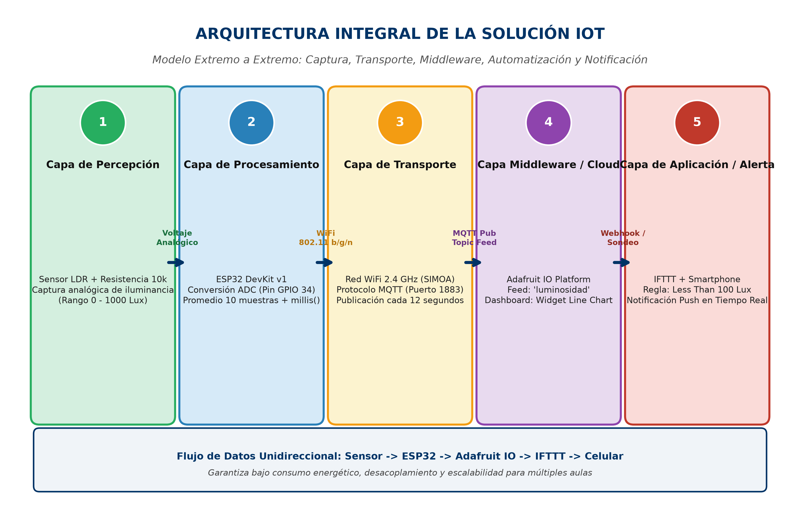
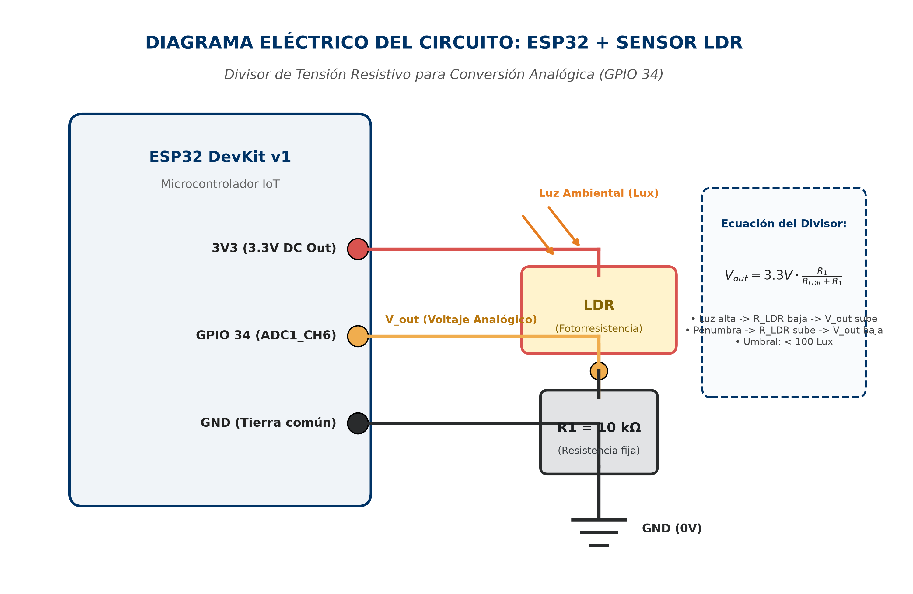
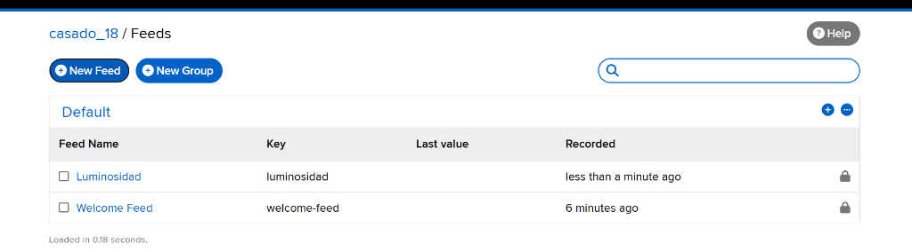
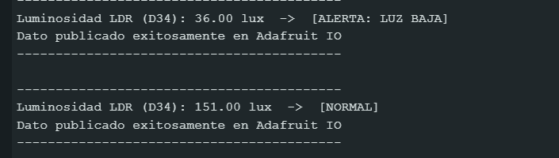
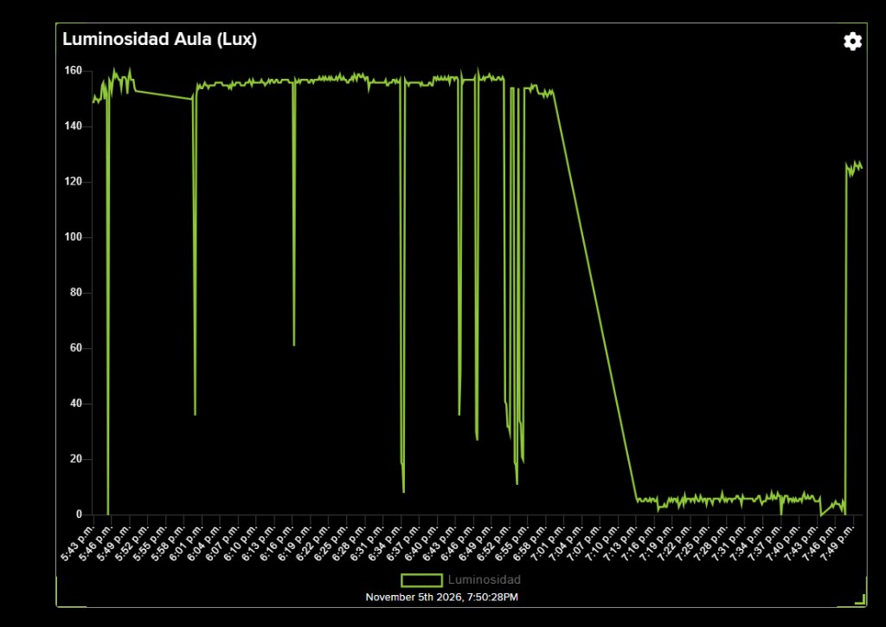
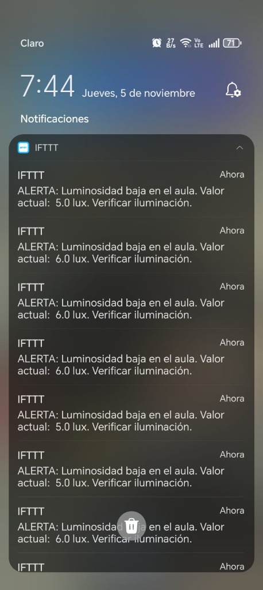

# Sistema IoT de Monitoreo Ambiental de Luminosidad y Alerta Temprana

**Integrantes:**  
* Cesar Casado Calderon 
* Brayan Esteban Cruz Arango  

**Usuario Adafruit IO:** `casado_18`  
**Semana:** 13 - Integración IoT en la Nube con MQTT e IFTTT  

---

## 1. Descripción del Proyecto

El presente proyecto responde a una situación real de gestión ambiental en instituciones educativas: el coordinador académico no puede monitorear de manera presencial o continua un panel de datos para detectar irregularidades en el confort visual de las aulas. 

Para solucionar esto, se implementó una solución de Internet de las Cosas (IoT) de extremo a extremo que automatiza el sensado, transporte, almacenamiento, visualización y generación de alertas tempranas. Cuando la luminosidad desciende por debajo del umbral crítico de **100 lux** (simulando una falla en el fluido eléctrico o apagado involuntario de luces), el sistema notifica de forma inmediata y automática al dispositivo móvil del responsable mediante notificaciones Push.

---

## 2. Arquitectura Integral del Sistema IoT

La solución se estructuró siguiendo el modelo estándar de Internet de las Cosas en cinco capas funcionales desacopladas:

1. **Capa de Percepción:** Sensor LDR (fotorresistencia) en divisor resistivo para capturar el flujo luminoso ambiental (0 - 1000 lux).
2. **Capa de Procesamiento:** ESP32 DevKit v1 realizando conversión analógica en GPIO 34 (ADC), filtrado de 10 muestras y temporización asíncrona con `millis()`.
3. **Capa de Transporte:** Red WiFi local 2.4 GHz y protocolo ligero MQTT (puerto 1883) publicando cada 12 segundos hacia el tópico `casado_18/feeds/luminosidad`.
4. **Capa Middleware / Cloud:** Plataforma Adafruit IO para almacenamiento, ingesta de telemetría y dashboard con widget *Line Chart*.
5. **Capa de Aplicación y Alerta:** Plataforma IFTTT evaluando la condición `Less Than 100 Lux` y despachando notificaciones push instantáneas a la app móvil.

---

## 3. Diagrama Eléctrico y Conexión de Hardware

* **Microcontrolador:** ESP32 DevKit v1 (30 pines)
* **Sensor:** Fotorresistencia LDR (Light Dependent Resistor)
* **Resistencia de referencia:** 10 kΩ (divisor de tensión resistivo)

### Diagrama Esquemático del Circuito:

### Esquema de Conexiones:
* **Pin 1 del LDR:** Conectado al riel de alimentación **3.3V** del ESP32.
* **Pin 2 del LDR:** Conectado al nodo de señal entre el pin **GPIO 34 (ADC)** del ESP32 y un terminal de la resistencia fija de 10 kΩ.
* **Segundo terminal de la resistencia de 10 kΩ:** Conectado al riel común de **GND (Tierra)** del ESP32.

### Ecuación de Transferencia del Divisor:
$$V_{out} = 3.3\,\text{V} \cdot \frac{R_1}{R_{LDR} + R_1}$$
* Con luz alta ambiental: $R_{LDR}$ desciende a pocos cientos de ohms, por lo que $V_{out}$ se aproxima a 3.3V.
* En penumbra u oscuridad (< 100 lux): $R_{LDR}$ se incrementa drásticamente (decenas o cientos de kΩ), haciendo que $V_{out}$ descienda bruscamente hacia 0V.

---

## 4. Evidencias Verificables

### 4.1 Creación del Feed en Adafruit IO
Feed `luminosidad` configurado bajo el usuario `casado_18`:

### 4.2 Monitor Serial y Publicación MQTT
Monitor Serial operando a 115200 baudios, mostrando conexión WiFi, lecturas en lux, discriminación de umbral crítico y confirmación de publicación MQTT:

### 4.3 Dashboard y Gráfico Histórico de Tendencias
Evolución de la luminosidad en el aula durante más de dos horas de monitoreo continuo (5:43 p.m. a 7:50 p.m.), con visualización de estados normales (~155 lux), valles anómalos inducidos (5.0 a 6.0 lux) y posterior restablecimiento (~125 lux):

### 4.4 Applet Configurado en IFTTT
Applet configurado bajo el modelo Trigger-Action (`This -> That`) vinculado al feed `luminosidad`:

### 4.5 Notificación Push Recibida en el Celular
Notificaciones push recibidas en tiempo real en la pantalla del smartphone a las 7:44 p.m., alertando sobre valores críticos de 5.0 y 6.0 lux:

---

## 5. Código Fuente Comentado

El código fuente completo se encuentra disponible en [`codigo/esp32_luminosidad.ino`](codigo/esp32_luminosidad.ino), implementando:
* Temporización asíncrona no bloqueante con `millis()`.
* Rutina de reconexión automática `reconnect()` para mantener persistente la sesión MQTT.
* Mapeo de valores analógicos a escala fotométrica (lux).

---

## 6. Conclusiones sobre la Automatización en IoT

1. **Eficiencia y Ahorro de Recursos:** La automatización basada en eventos evita que los operadores humanos deban mantener una vigilancia pasiva sobre tableros de control. Los microcontroladores y la nube se encargan de la vigilancia continua y solo intervienen ante discrepancias operativas.
2. **Escalabilidad del Ecosistema:** El uso de MQTT como capa de transporte combinada con plataformas puente (como IFTTT o Node-RED) permite desacoplar los dispositivos de campo de las aplicaciones de usuario final, permitiendo integrar múltiples sensores adicionales (temperatura, CO2, presencia) sin necesidad de reescribir la arquitectura base.
3. **Mantenimiento Preventivo y Confort:** En entornos educativos y de oficina, el control automatizado de la luminosidad no solo garantiza el cumplimiento de normativas de salud visual y ergonomía, sino que además permite auditar patrones de consumo eléctrico.
